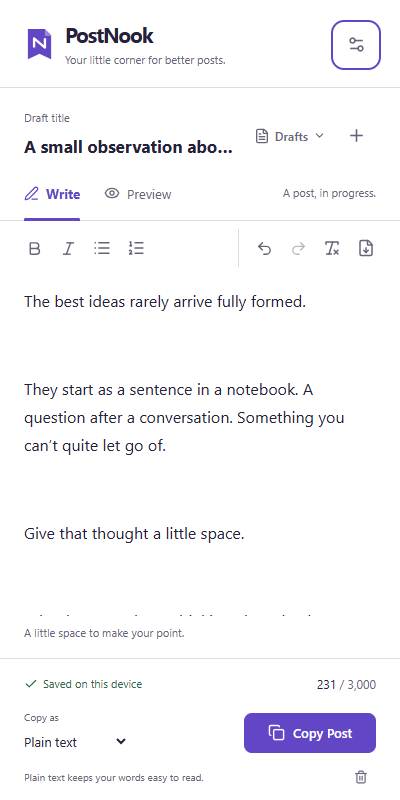

# PostNook

**Post Editor for LinkedIn**

Your little corner for better posts.

PostNook is a free, local-first Chrome and Edge extension for writing LinkedIn posts in the browser side panel. Write, format, import Markdown, save drafts, preview the generated text, and copy it to publish manually.



## Project status

The technical foundation and working UI are implemented. This is an unpacked development build, not a marketplace release. The [foundation review](docs/design/ui-review.md) remains open for human accessibility and three-writer usability checks. Later feature and release epics retain their own acceptance gates.

- [Product requirements, version 1.0](docs/PRD.md)
- [Original supplied PRD](docs/PRD.source.txt)
- [Epics and child issues](docs/backlog-index.md)
- [Machine-readable backlog](docs/backlog.json)
- [Foundation implementation status](docs/implementation-status.md)
- [Architecture](docs/architecture.md) and [Markdown decision](docs/decisions/001-markdown-adapter.md)
- [Design system](docs/design/design-system.md) and [prototype walkthrough](docs/design/prototype/README.md)

## Run locally

Use Node.js 22.12 or later and npm. The lockfile pins dependencies.

```sh
npm ci
npm run dev -- --port 4173
```

Open `http://127.0.0.1:4173/sidepanel.html`. The development page uses its own IndexedDB and localStorage; its drafts are separate from the extension. The development-only component showcase is at `sidepanel.html?studio`. Its simulated states are explicitly labelled.

## Load the extension

```sh
npm run build
```

1. Open `chrome://extensions` or `edge://extensions` and enable developer mode.
2. Choose **Load unpacked**, then select this repository's `dist` directory.
3. Pin PostNook and click its toolbar icon to open the native side panel.
4. Create a post, wait for **Saved on this device**, then copy it.

Rebuild and reload the extension after source changes. Chrome minimum manifest version is 116; tested versions and remaining compatibility work are in [browser testing](docs/testing/browser-testing.md).

## Checks and packages

```sh
npm run validate
npx playwright install chromium
npm run test:e2e -- --project=chromium
# With Chrome and Edge installed:
npm run test:e2e -- --project=chrome --project=edge
npm run package
```

`validate` runs strict TypeScript, ESLint, formatting, unit/integration tests, the production build, and manifest validation. `package` writes separate Chrome and Edge ZIPs plus SHA-256 checksums to `artifacts/`. No store submission or public release is performed.

The [native-panel probe](docs/testing/browser-testing.md) separately tests packaged action-click opening, clipboard read-back, and restart persistence. Browser UI tests cover narrow layouts, Unicode warnings, sanitization, save failures, and concurrent edits.

## Product boundaries

Drafts remain on the device. The product requires no account, backend, LinkedIn credentials, page access, scraping, or automatic publishing. Users copy the generated text, paste it into LinkedIn, and publish manually.

Plain text is the default output. Optional Unicode emphasis requires an accessibility warning. Preview and character counts are estimates of the publishing result; compatibility must be validated.

**Uninstalling the extension or clearing its storage can delete drafts.** Keep a separate copy of important posts. Read [privacy and data limitations](docs/privacy.md).

## Implementation sequence

Sprint 0 now supplies the React/TypeScript/Vite project, native panel, clipboard, transactional storage, Tiptap, Markdown adapter, serializer, and UI baseline. Complete the remaining human design review, then continue with the PRD's writing, persistence, and release sprints.

The backlog retains E01-E07 and US-001-US-013 from the PRD. E00, E08, E09, and prefixed engineering tasks decompose its foundation, quality, and release requirements. Derived tasks are not given invented story-point estimates. Future v0.2, v0.3, and v1.0 ideas remain in the PRD outside the MVP backlog.

## Document provenance

`docs/PRD.source.txt` preserves the supplied PRD verbatim. `docs/PRD.md` adds Markdown headings and tables for navigation without revising requirements. External API, library, platform, and policy statements are supplied assumptions to validate during implementation.
